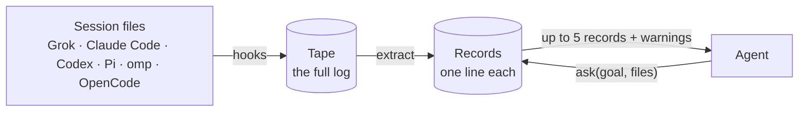

<h1 align="center">lossless</h1>

<p align="center">
  Memory for coding agents that survives compaction, new sessions, and a change of tool.
</p>

<p align="center">
  <a href="docs/README.md">Docs</a>
  ·
  <a href="https://github.com/jbgh/lossless/releases/latest">Releases</a>
  ·
  <a href="CHANGELOG.md">Changelog</a>
</p>

<p align="center">
  <a href="LICENSE"></a>
  <a href="https://github.com/jbgh/lossless/releases/latest"></a>
  <a href="https://go.dev"></a>
</p>

The session log is the memory. Compact is lossy. lossless is not.

## The problem

A coding agent only sees a small window of its session. When the window fills up, the harness **compacts** it: early turns are replaced by a short summary. On a long project this happens again and again.

Say an agent tries a Redis token bucket for rate limiting, watches it exhaust the connection pool in staging, and ships a fixed-window counter instead. A few compacts later all that is left is *"tried Redis, switched to fixed window."* A new session asks "why not Redis?", finds nothing, and spends another afternoon failing the same way.

Decisions get re-argued, rules the user stated once get broken, and dead ends look like fresh ideas. None of it carries over to a new session, a new model, or a different tool.

The full session file is still on disk the whole time. Only the window forgets.

## How it works



1. **Record.** Hooks copy every session file onto an append-only tape in `~/.lossless/raw`. The tape is kept even if the harness deletes its own copy.
2. **Index.** lossless reads the tape and writes one-line records: what failed, what was decided, what rules were set, where work stopped. It also keeps everything you typed, word for word. The agent can add records of its own with `remember`. Each record points back to the part of the tape it came from.
3. **Ask.** Before it changes anything, the agent calls `ask` with its goal and the files it is about to touch. It gets back the records that apply, at most five, plus warnings. Failed work comes first.

Memory belongs to the repository (`owner/repo`), not to a model or a tool. Start in Claude Code, continue in Codex, and `ask` returns the same history.

## Install

```bash
curl -fsSL https://github.com/jbgh/lossless/releases/latest/download/install.sh | sh
lossless setup     # hooks, MCP server, skill, and a background service
lossless doctor    # checks that everything is connected
```

Then start a new agent session. From there the agent calls `ask` on its own. There is nothing to type.

- Runs on macOS and Linux (amd64, arm64). The binary is installed to `~/.local/bin/lossless`.
- `setup` covers Grok, Claude Code, Codex, Pi, omp, and OpenCode. It adds a short rule to each one's instructions file, only between `<!-- lossless:start -->` and `<!-- lossless:end -->` markers.
- In a Grok session that is already open, reload with `/hooks` then `r`, and `/skills` then `r`.
- Upgrade with `lossless update`. Check first with `lossless update --check`.

<details>
<summary>Build from source</summary>

```bash
go test ./...
go build -o lossless ./cmd/lossless
./lossless setup
./lossless doctor
```

</details>

## What the agent gets

The agent sends what it is about to do:

```json
{
  "workspace_root": "/Users/you/dev/api",
  "goal": "add rate limiting",
  "paths": ["src/middleware/auth.ts"]
}
```

lossless answers with the records that bear on it:

```json
{
  "context": [
    {
      "id": "01J...",
      "type": "failed",
      "text": "Redis token bucket failed in staging; connection pool exhausted.",
      "when": "2026-08-01T18:12:00Z",
      "paths": ["src/middleware/auth.ts"],
      "status": "active",
      "has_excerpt": true
    }
  ],
  "warnings": [
    "A prior attempt at this goal failed (see 01J...). Do not repeat it without new evidence."
  ],
  "tokens": 412,
  "project": "acme/api"
}
```

There are six kinds of record:

| Type | What it holds |
|------|---------------|
| `failed` | An approach that did not work, and why. Returned first. |
| `decision` | Something that shipped: a library, a design, a settled tradeoff. |
| `constraint` | A rule that must keep holding ("never touch `.woodpecker/**`"). |
| `state` | Where work stopped: a pending migration, a half-done refactor. |
| `thread` | An open question to come back to. |
| `said` | A quote of something you typed in an earlier session. Context, never a warning or an instruction. |

A record is a one-line summary, never the whole story. `get_record` opens the tape excerpt behind any `id`.

Warnings flag four things: an earlier attempt at this goal that failed, shipped work that may already cover the goal, a standing rule the goal touches, and a failure that keeps recurring in the project. A record only comes back if it shares a file, an identifier, or enough of the goal's words with the ask. When nothing applies, the answer is empty.

## Using it yourself

The agent's tools are also a CLI:

```bash
lossless ask --project owner/repo --goal "add rate limiting" --path src/middleware/auth.ts
lossless remember --type decision --text "Use jose, not jsonwebtoken, on Edge." --project owner/repo
lossless inspect --project owner/repo --ask    # why each record was returned or dropped
lossless supersede <id> "no longer true"       # retire a record; nothing is deleted
lossless backfill                              # after an upgrade: read old tapes with the new version
```

The same JSON is served over MCP (`ask`, `remember`, `get_record`) and REST (`POST /v1/ask`), so any agent that can call either one can share the store. `lossless help` lists every command.

## Private by default

- **Local.** Everything lives in `~/.lossless`. The service listens on `127.0.0.1`. Nothing is uploaded.
- **No model in the loop.** Retrieval is fixed code: no LLM, no hosted embeddings. The agent writes the reply; lossless only supplies records.
- **No network.** Out of the box, `lossless update` is the only command that goes online, and only to GitHub Releases.
- **Backup is optional and yours.** `lossless backup` copies the store, encrypted with a key you hold, to an S3-compatible bucket you own (AWS, R2, B2, MinIO). `lossless restore` brings it back. See [docs/deploy.md](docs/deploy.md), which also covers running the store on another machine.

What is on disk:

```
~/.lossless/raw/<owner>__<repo>/…/<session>.jsonl   the tape (kept forever)
~/.lossless/export/<owner>__<repo>/<id>.md          records, as readable files
~/.lossless/index/                                  SQLite index, rebuildable from the tape
```

`LOSSLESS_HOME` moves the directory.

## What it is not

- **Not a summarizer.** A summary throws the transcript away, and the failed path with it. lossless keeps the transcript.
- **Not a dump.** An ask returns at most five records, not the log.
- **Not automatic injection.** Nothing is pushed into the prompt. The agent has to call `ask`; `setup` installs the rule and the skill that tell it to.
- **Not a hosted service.** There is no account and no cloud.
- **Not a general knowledge base.** It is memory for coding sessions on a repository.

## Documentation

- [Architecture](docs/architecture.md): the whole system on one page
- [How ask picks records](docs/algorithm.md), and the full [retrieval spec](docs/retrieval.md)
- [The `ask` / `remember` / `get_record` contract](docs/ask.md)
- [How the tape and records are written](docs/write.md)
- [Harness adapters](docs/harnesses.md) · [Deploy and backup](docs/deploy.md) · [Retiring records](docs/supersede.md)
- [Evaluation](docs/eval.md) · [Roadmap](docs/roadmap.md) · [All docs](docs/README.md)

## License

Apache-2.0. See [LICENSE](LICENSE).
